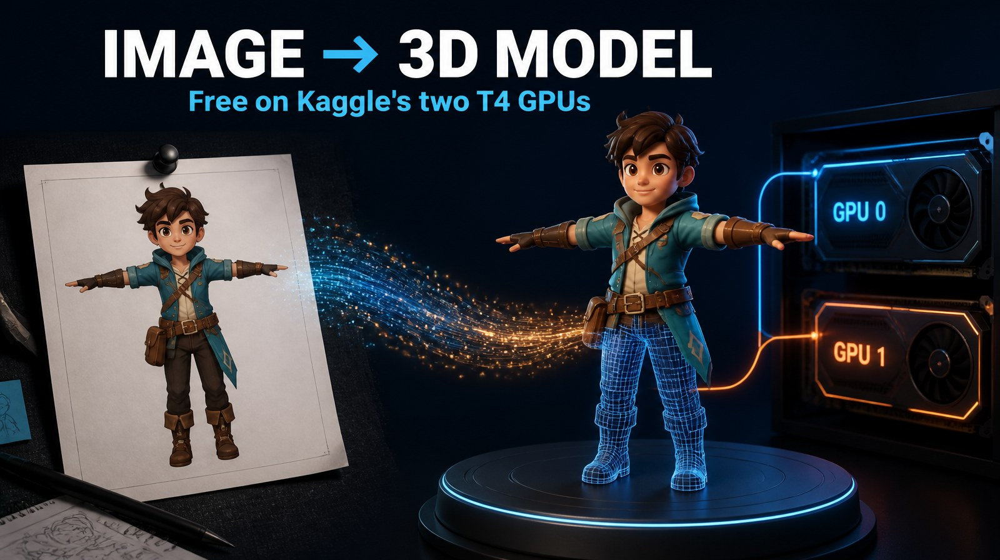

# Hunyuan3D 2.1 on Kaggle (free, both T4 GPUs)

A free Kaggle notebook that turns images into textured 3D models (`.glb` with PBR textures) using
[Tencent Hunyuan3D 2.1](https://github.com/Tencent-Hunyuan/Hunyuan3D-2.1).

Hunyuan3D 2.1 needs about 29 GB of VRAM to run shape and texture together. No free GPU has that much, but Kaggle
gives you **two 16 GB T4s** in one session. This notebook puts each stage on its own GPU:

| GPU | Worker | Does |
|---|---|---|
| `cuda:0` | `shape_worker.py` | removes the background, then image to untextured mesh |
| `cuda:1` | `paint_worker.py` | untextured mesh to PBR texture (multiview diffusion, upscaler, baking) |

The two workers are separate processes linked by a small folder queue, so while GPU 1 is texturing model N,
GPU 0 is already shaping model N+1. With only one GPU, the stages run one after the other.

## Files

| File | What it is |
|---|---|
| `hunyuan3d_2_1_kaggle_dual_t4.ipynb` | The main notebook: install, load weights, run both GPUs, zip the results |
| `hunyuan3d_2_1_weights_builder.ipynb` | Run once (no GPU needed) to save the 17.8 GB of weights as your own private Kaggle dataset |
| `build_notebook.py` | The source both notebooks are generated from. Edit this, then run `python build_notebook.py <output_dir>` |

## Quick start

**Once:** build the weights dataset, so the 17.8 GB doesn't download every session.

1. Import `hunyuan3d_2_1_weights_builder.ipynb` into Kaggle (**File → Import Notebook**).
2. **Settings → Accelerator → None**, **Internet → On**.
3. **Save Version → Save & Run All (Commit)** and wait for it to finish (about 10 to 20 minutes).
4. Open the finished version, go to **Output → New Dataset**, name it e.g. `hunyuan3d-2-1-weights`, keep it **Private**.

**Every time:**

1. Open the main notebook (badge above, or **File → Import Notebook**).
2. **Settings → Accelerator → GPU T4 x2**, **Internet → On** (needs a phone-verified Kaggle account).
3. **Add Input → Upload** a folder of images. A PNG with a transparent background works best; other images get their background removed automatically.
4. **Add Input → Your Datasets →** your weights dataset. It's found automatically.
5. **Run All.** Setup takes about 10 minutes (installs and compiling the CUDA rasterizer).

Results go to `/kaggle/working/hy3d_out/<image name>/textured_mesh.glb` and get zipped into
`/kaggle/working/hy3d_results.zip`. The last cell previews a model right in the notebook.

For long batches, use **Save Version → Save & Run All (Commit)** so it keeps running after you close the tab.
Without a weights dataset, the notebook still works; it downloads the weights each session (5 to 10 minutes more).

## Settings

All in the settings cell:

| Setting | Default | Notes |
|---|---|---|
| `octree_resolution` | 256 | 384/512 gives finer geometry, more VRAM and time |
| `steps` | 30 | the official demo default; 50 is slightly sharper |
| `max_faces` | 40000 | 200000 keeps faces and fingers much sharper (slower texturing) |
| `texture_views` | 6 | 6 to 9; the official demo uses 8 on a 24 GB card |
| `texture_resolution` | 512 | 512 is safe on a 16 GB T4; 768 may run out of memory |
| `seed` | 1234 | change it to get a different shape from the same image |
| `skip_existing` | True | re-running only does the images that aren't finished |

## What it fixes compared to running the repo as-is on Kaggle

- **Installs on Kaggle's PyTorch** without reinstalling torch, with pins that work on Python 3.13
  (`basicsr`/`realesrgan` are replaced with `spandrel`, which loads the same RealESRGAN weights; `bpy` is made optional).
- **Compiles the CUDA rasterizer only for the GPUs in the session**, which is much faster than building for every architecture.
- **Loads weights fast:** Kaggle streams dataset files at about 17 MB/s for one reader, so models took 7+ minutes each to load.
  The weights are copied to local disk with 16 parallel readers while the install runs.
- **Keeps your face count:** the repo's remesh step needs `open3d` (not installed, so it crashes) and cuts every mesh to 40k faces.
  It's replaced with a `pymeshlab` decimation that respects `max_faces`.
- **Valid GLB files:** textures are embedded in the binary chunk with the right MIME type, so the models also show
  their textures in Windows 3D Viewer and stricter importers, not only in web viewers.

## Troubleshooting

- **`OUT OF GPU MEMORY` in the paint log:** keep `texture_resolution=512` and lower `texture_views` to 6. For shape-stage OOM, lower `octree_resolution` or `num_chunks`.
- **`nvcc not found`:** the session has no GPU. Set the accelerator to GPU T4 x2 and restart.
- **Install fails on a package:** Kaggle updates its image regularly. The error usually names the package; loosen that pin in `install.sh` and rerun the cell.
- **Session restarted:** `/tmp` is wiped, so rerun everything. `skip_existing=True` resumes where it stopped.
- Full worker logs: `/tmp/hy3d/shape_worker.log` and `/tmp/hy3d/paint_worker.log`.

## License

The notebook code in this repo is MIT licensed (see [LICENSE](LICENSE)).

Hunyuan3D 2.1 itself, its weights and its outputs are under the
[Tencent Hunyuan 3D 2.1 Community License](https://github.com/Tencent-Hunyuan/Hunyuan3D-2.1/blob/main/LICENSE).
Read it before any commercial use. It does not cover the EU, the UK or South Korea.
